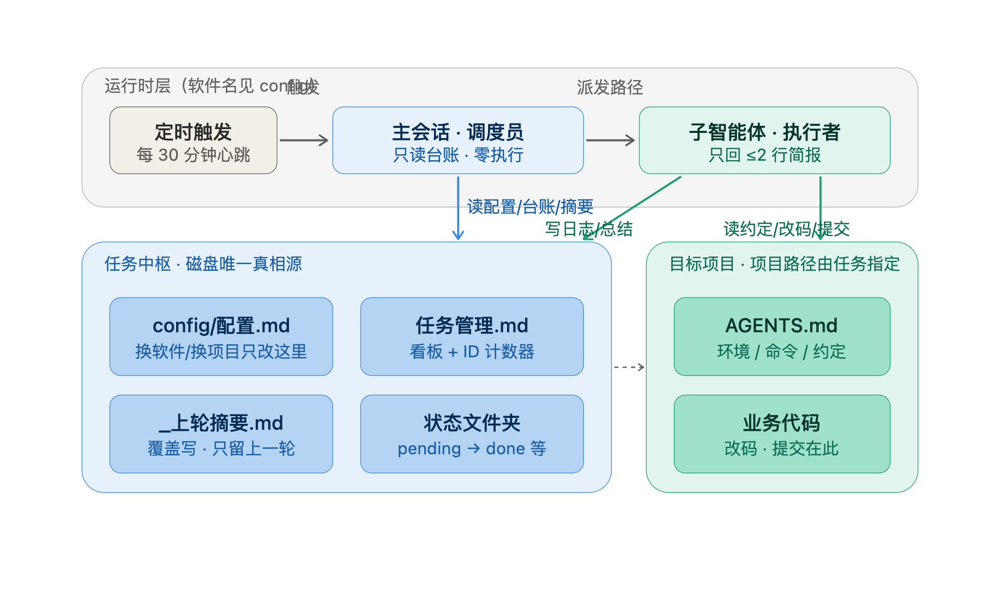
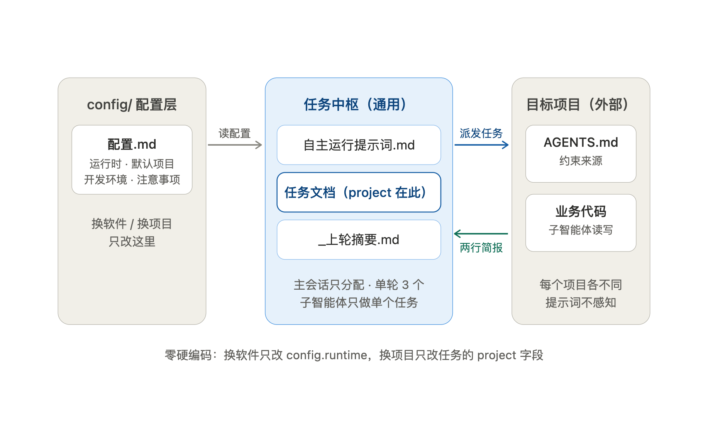
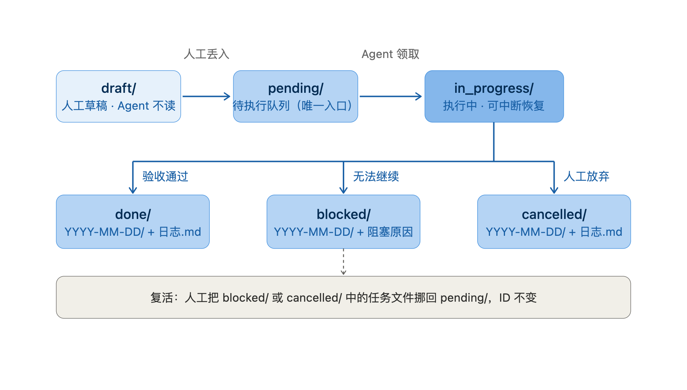
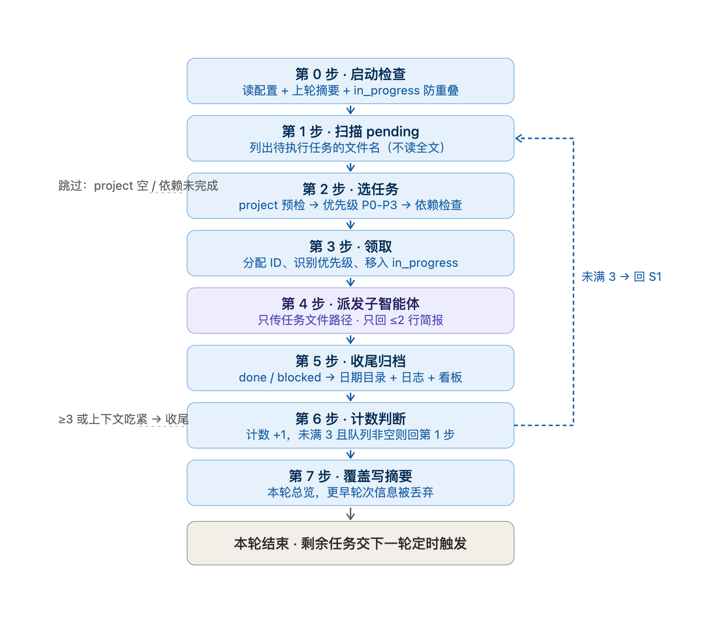
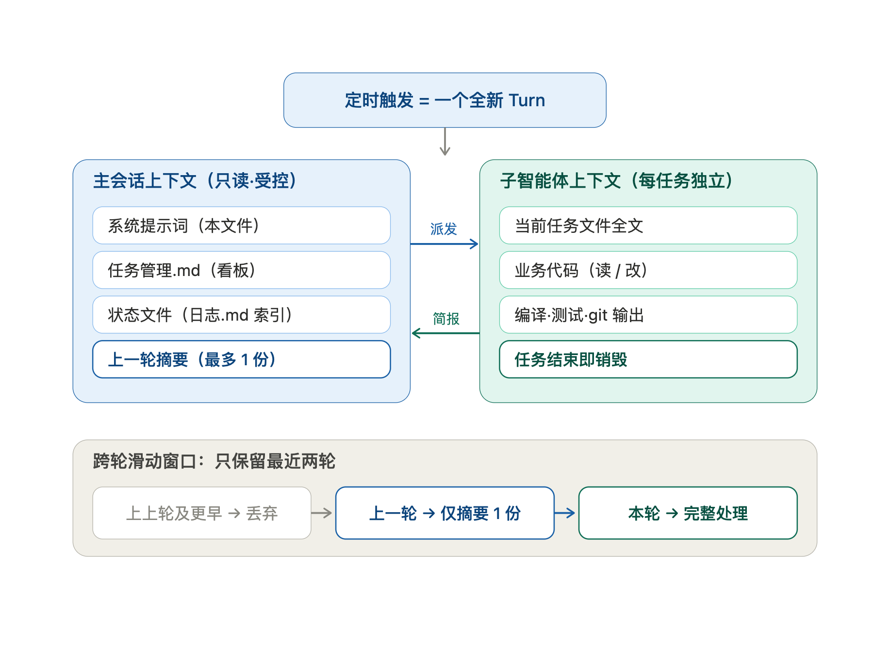
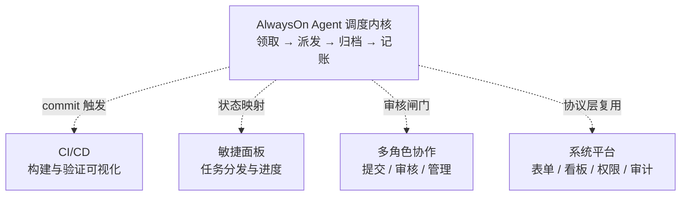

<div align="center">

# AlwaysOn Agent

### 常驻式自主任务框架 · 让 Agent 永不下班

一份提示词 + 一个文件夹，构建 7×24 自动运转的 Agent 任务流水线。
主会话只调度，子智能体只执行；任务丢进 `pending/`，醒来就有结果。


</div>

---

## 它解决什么问题

让 Agent 写过代码的人，大多撞过这几堵墙：

| 痛点 | AlwaysOn Agent 的解法 |
|---|---|
| 每个需求都要手动把上下文贴一遍 | 任务写成 Markdown 丢进 `pending/`，定时心跳自动领取执行 |
| 聊着聊着上下文就爆了 | 主/子上下文隔离 + 单轮上限 + 跨轮只带一份摘要，占用恒定 |
| 换个项目、换款 AI 软件就要重写提示词 | 项目特性全部外置到 `config/配置.md` 与目标项目的 `AGENTS.md` |
| Agent 崩了任务就丢了 | 文件夹即状态 + 执行日志落盘，下一轮自动续做而非重做 |
| 多个任务混在一起，不知道谁在做 | 看板 + 日期归档 + 日志索引，全程可追溯 |

**一句话**：把 Agent 从「你问一句它做一句」的聊天窗口，变成「你丢任务它自己跑」的常驻服务。

---

## 核心特性

- **常驻运行**：定时触发心跳，持续监测 `pending/`；有任务就干，没任务就安静退出。
- **双脑分工**：主会话（调度员）只领取、派发、归档、记账，一行业务代码都不读；子智能体（执行者）独占上下文，读码、改码、编译、提交，结束只回两行简报。
- **文件夹即状态**：任务的真实状态就是它所在的目录，不依赖内存或数据库，Agent 重启不丢状态。
- **上下文恒定**：三道防线——轮次隔离、单轮上限（默认 3）、派发只传路径，占用不随任务数和轮次增长。
- **配置驱动**：运行时软件、默认项目、约定文档名、单轮上限全在 `config/配置.md`；换环境只改一处，提示词一行不动。
- **项目无关**：目标项目由每个任务的 `frontmatter.project` 指定，可同时服务多个项目、任意技术栈。
- **失败可追踪**：阻塞写明原因，中断按执行日志续做，人工把文件挪回 `pending/` 即可复活。

---

## 架构一图看懂



主会话只和中枢磁盘文件打交道，**目标项目不在中枢内部**，它永远不碰业务代码——这是上下文不被撑爆的根本原因。

框架之所以能「一套提示词跑任何项目、任何软件」，靠的是三层解耦：



换软件只改 `config/配置.md` 的 `agent_runtime`，换项目只改任务的 `project` 字段，提示词本身一行不动。

---

## 快速开始

**1. 配一次** — 编辑 `config/配置.md`，填 `hub_root`（中枢绝对路径）与 `default_project`（可留空，改由每个任务单独指定）。

**2. 启动循环** — 把 `自主运行提示词.md` 提示词区的全文作为系统提示词（或第一条消息）发给你的 Agent。

**3. 建任务** — 复制 `draft/_模板.md`，改文件名，填标题、问题描述、关联文件、验收标准，勾选优先级，在 `frontmatter.project` 填目标项目路径，丢进 `pending/`。`id`、`created`、`status`、`priority` 都不用填，Agent 自动处理。

**4. 挂定时（可选）** — 在定时插件里每 30 分钟重发一次提示词，即可 7×24 无人值守。

> 第一次接入项目时，可以先用内置任务自动生成该项目的 `AGENTS.md`：把 `pending/内置-生成项目约定文档.md` 的 `project` 填好，下一轮就会被领取执行。

---

## 任务如何流转



任务的真实状态就是它所在的文件夹，frontmatter 的 `status` 只是展示镜像。每个 `done/`、`blocked/`、`cancelled/` 下按 `YYYY-MM-DD/` 归档，并有 `日志.md` 做索引；看板 `任务管理.md` 由 Agent 自动维护。

---

## 单轮调度循环

一次定时触发 = 一个 Turn，最多处理 N 个任务（默认 3）。达到上限或上下文吃紧就收尾，余量交下一轮——用多轮换上下文恒定。



跨轮只通过 `_上轮摘要.md` 传递最近一轮结果；它每轮被整体覆盖，更早的信息物理上不再存在，所以「上上次」无法带入当前。

---

## 上下文是怎么做到恒定的



三道防线协同工作：

1. **轮次隔离**：每次定时触发 = 全新 Turn，唯一允许带入的历史是一份上一轮摘要。
2. **单轮上限**：一个 Turn 最多处理 N 个任务，达到上限立即收尾，不为清空队列硬撑。
3. **上下文分层**：主会话只读白名单内容（配置、看板、目录名、当前任务头部字段、摘要）；子智能体一任务一上下文，执行细节用完即弃，只回传两行简报。

---

## 目录结构

```
<任务中枢>/
├── README.md
├── config/
│   └── 配置.md               # 全局配置入口（换软件/换项目只改这里）
├── 自主运行提示词.md         # 核心：喂给 Agent 的通用系统提示词
├── 工作流设计.md             # 运行机制与状态机设计
├── 任务管理.md               # 任务看板（Agent 自动维护）
├── 插件清单.md               # 定时/子智能体等能力的软件适配说明
├── _上轮摘要.md              # 跨轮摘要（覆盖写，只留最近一轮）
├── img/                      # 架构与流程图
├── draft/                    # 草稿区（Agent 永不读写）
│   ├── _模板.md
│   ├── _内置-生成项目约定文档.md
│   ├── _内置-探测项目环境.md
│   └── 示例-*.md
├── pending/                  # 待执行队列（唯一入口）
├── in_progress/              # 执行中
├── done/                     # 已完成，按日期归档 + 日志.md
├── blocked/                  # 阻塞，按日期归档 + 日志.md
└── cancelled/                # 取消，按日期归档 + 日志.md
```

---

## 内置任务

`pending/` 里预置了两个开箱即用的任务，默认 `project` 为空所以会被跳过——这是设计如此，填好路径即可生效：

| 任务 | 作用 |
|---|---|
| `内置-生成项目约定文档.md` | 探测目标项目的技术栈、环境与命令，产出该项目的 `AGENTS.md`，之后所有任务都能读到真实约束 |
| `内置-探测项目环境.md` | 快速摸清一个陌生项目的结构、构建方式与注意事项 |

内置任务和普通任务走完全相同的流程，没有任何特殊分支；给别的项目也来一份时，从 `draft/` 复制对应模板到 `pending/` 即可。

---

## 适用场景

- 个人开发者或小团队想搭一条**自动化开发流水线**，把重复需求批量交给 Agent。
- 需要 7×24 跑**批量重构、测试补齐、文档生成**等耗时任务。
- 同时维护**多个项目**，希望用一个中枢统一调度而不为每个项目重写提示词。
- 已经在用 Agent，但苦于**上下文爆炸**和**任务状态丢失**，想要一层可靠的调度大脑。

---

## 可扩展项

核心循环刻意保持极简——它只回答一个问题：「任务如何被可靠地领取和执行」。下面这些方向都是在**不改动调度内核**的前提下，围绕它叠加的外围能力。文件驱动 + 配置解耦的设计，让它们可以按需逐个接入、渐进演进。



### 1. 接入 CI/CD：从「任务完成」到「构建可见」

子智能体在目标项目内 `git commit` 之后，把后续交给 CI 接管：自动构建、跑测试、生成产物与报告，并把结果回写成任务状态或仓库徽章。Agent 负责「把代码写出来」，CI 负责「证明代码可用」——两者职责彻底分离。

- **触发点**：子智能体的 commit / push webhook。
- **回写方式**：CI 成功后在任务「总结」追加验证记录、刷新 README 状态徽章、或给任务打上 `verified` 标记。
- **收益**：验收标准从「Agent 自称通过」升级为「流水线客观背书」，自动化闭环的最后一环被补上。

### 2. 对接敏捷面板：任务分发与进度可视化

把任务文件与敏捷看板（GitHub Projects / Jira / 禅道等）做双向映射：看板卡片生成任务文件，文件夹状态同步回看板列。团队在熟悉的面板上创建和追踪问题，中枢在后台静默消化。

| 任务中枢状态 | 看板列 |
|---|---|
| `draft/` | Backlog |
| `pending/` | Todo |
| `in_progress/` | In Progress |
| `done/` | Done |
| `blocked/` | Blocked |

分发规则可按标签、负责人或模块路由到不同的中枢实例或子智能体池，实现「多队列、专人专用」。

### 3. 多角色协作：让「谁能提交、谁能放行」可控

当前流程默认「提交即可执行」。扩展后引入角色分层，尤其适合多人协作与对外众包场景：

- **提交人**：只负责编写任务文件（提示词），提交后进入 `review/` 待审区，**不直接进入执行队列**。
- **审核员**：校验任务提示词的质量——描述是否清晰、验收标准是否可测、`project` 是否有效、优先级是否合理。通过后移入 `pending/`，驳回则退回并附修改意见。
- **管理员**：维护全局配置、角色权限与目标项目约定。

这层「审核闸门」能有效防止模糊、越权或危险的任务被自动执行。由于框架本就是「文件夹即状态」，只需新增一个 `review/` 状态与一个审核环节，调度内核无需改动。

### 4. 平台化演进：从文件驱动到可视化平台

当任务量、并发度与协作规模增长，可以演进为 Web 平台：任务表单化替代手写 Markdown、看板可视化、角色与权限体系、执行日志在线查阅、多目标项目与多中枢集中管理。底层仍复用同一套调度语义（领取 → 派发 → 归档 → 记账），只是把「文件与文件夹」升级为「数据库与界面」。

这条路径让 AlwaysOn Agent 既是一个开箱即用的轻量脚本方案，也可以成为未来平台的**协议层与调度内核**——先跑起来，再长成系统。

> 以上扩展均可渐进接入、按需取用；核心提示词与调度循环始终保持通用与稳定。

---

## 常见问题

| 问题 | 回答 |
|---|---|
| 支持哪些 Agent 软件？ | 不限定。只要具备文件读写、终端、子智能体派发、定时触发四种能力即可；软件名只写在配置里作说明。 |
| 任务为什么没被领取？ | 八成是 `project` 和 `default_project` 都为空，第 2 步会跳过它并给出提示。 |
| 队列很长会不会撑爆上下文？ | 不会。单轮最多处理 3 个，多轮接力；每轮读一份摘要、写一份摘要，占用恒定。 |
| 子智能体读码的上下文算主会话吗？ | 按独立上下文设计；执行细节留在子会话里，只回传两行简报，不回流主会话。 |
| Agent 中断了怎么办？ | 任务留在 `in_progress/`，下轮第 0 步按执行日志判断进度，续做而非重做。 |
| 没有 `AGENTS.md` 会怎样？ | 配置了兜底，默认按通用约定执行；也可以设为直接报 blocked 等人补齐。 |

---

## 贡献

欢迎提 Issue 和 PR。如果你加了新特性，记得同步更新 `工作流设计.md` 与 `config/配置.md` 的字段说明——提示词本身应保持通用，不掺入任何具体项目或软件的特性。

---

## 许可证

本项目采用 [MIT License](./LICENSE) 开源——你可以自由使用、复制、修改、合并、发布、分发、再授权，甚至商用，只需在副本或实质部分保留版权声明与许可文本。

---

<div align="center">

如果 AlwaysOn Agent 帮你把重复工作交给了 Agent，给仓库点一个 **Star**，让更多人看到这种「常驻式」的工作方式。

</div>
